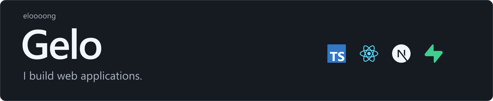
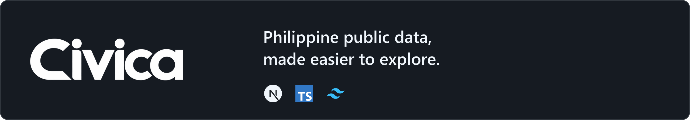
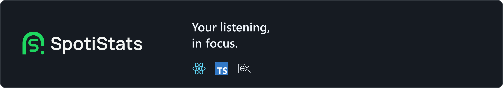
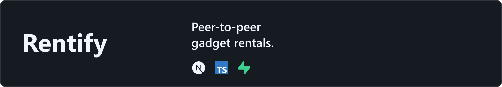

<picture>
  <source media="(max-width: 600px)" srcset="assets/profile-banner-mobile-v3.png">
  
</picture>

## Selected projects

<a href="https://github.com/eloooong/civica-web"><picture><source media="(max-width: 600px)" srcset="assets/civica-card-mobile-v3.png"></picture></a>

[Open Civica](https://civica-web-two.vercel.app) · [Source](https://github.com/eloooong/civica-web)

<a href="https://github.com/eloooong/spoti"><picture><source media="(max-width: 600px)" srcset="assets/spoti-card-mobile-v3.png"></picture></a>

[Open SpotiStats](https://spoti-neon.vercel.app) · [Source](https://github.com/eloooong/spoti)

<a href="https://github.com/eloooong/rentify-app"><picture><source media="(max-width: 600px)" srcset="assets/rentify-card-mobile-v3.png"></picture></a>

[Source](https://github.com/eloooong/rentify-app) · In development

---

[Email](mailto:angelobatara2002@gmail.com) · [All repositories](https://github.com/eloooong?tab=repositories)
