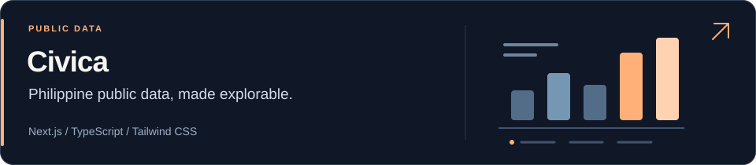
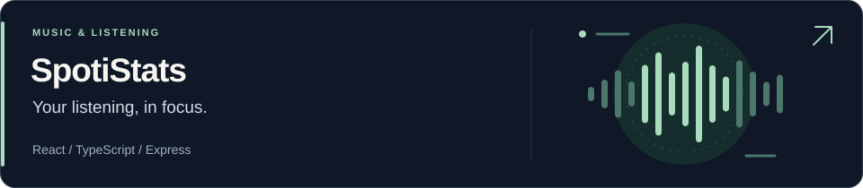
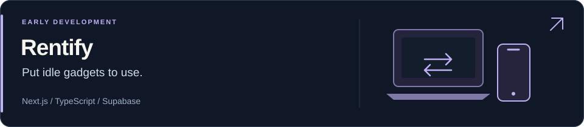

**TypeScript · React · Next.js · Supabase**

<a href="https://github.com/eloooong/civica-web"><picture><source media="(max-width: 600px)" srcset="assets/civica-card-mobile.svg"></picture></a>

<a href="https://github.com/eloooong/spoti"><picture><source media="(max-width: 600px)" srcset="assets/spoti-card-mobile.svg"></picture></a>

<a href="https://github.com/eloooong/rentify-app"><picture><source media="(max-width: 600px)" srcset="assets/rentify-card-mobile.svg"></picture></a>

[Try Civica ↗](https://civica-web-two.vercel.app) · [All repositories](https://github.com/eloooong?tab=repositories) · [Email](mailto:angelobatara2002@gmail.com)
