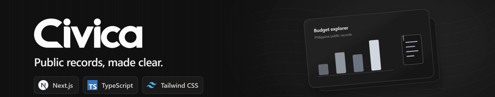
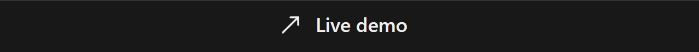
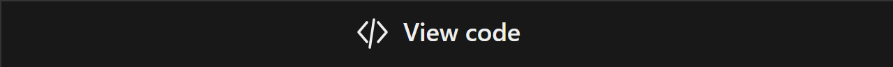
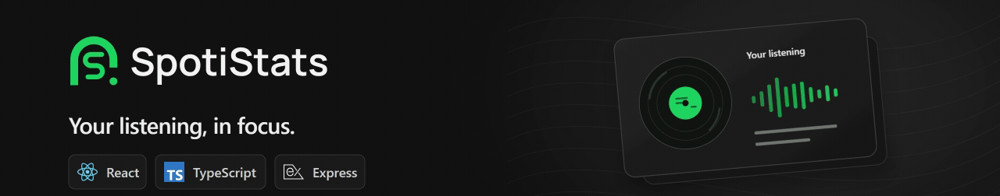
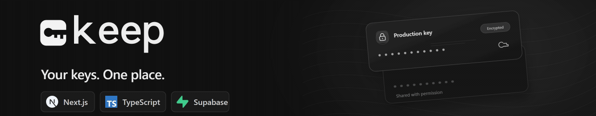
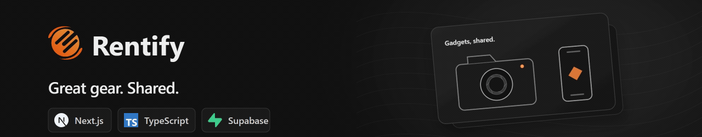
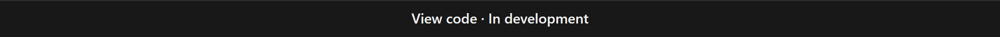

<picture>
  <source media="(max-width: 600px)" srcset="assets/profile-banner-mobile-v3.png">
  
</picture>

## Selected projects

<a href="https://civica-web-two.vercel.app"><picture><source media="(prefers-reduced-motion: reduce) and (max-width:600px)" srcset="assets/project-banners/civica-mobile.png"><source media="(prefers-reduced-motion: reduce)" srcset="assets/project-banners/civica.png"><source media="(max-width:600px)" srcset="assets/project-banners/civica-animated-mobile.gif"></picture></a> <a href="https://civica-web-two.vercel.app"><picture><source media="(max-width:600px)" srcset="assets/project-banners/action-live-mobile.png"></picture></a><a href="https://github.com/eloooong/civica-web"><picture><source media="(max-width:600px)" srcset="assets/project-banners/action-code-mobile.png"></picture></a>

<a href="https://spoti-neon.vercel.app"><picture><source media="(prefers-reduced-motion: reduce) and (max-width:600px)" srcset="assets/project-banners/spoti-mobile.png"><source media="(prefers-reduced-motion: reduce)" srcset="assets/project-banners/spoti.png"><source media="(max-width:600px)" srcset="assets/project-banners/spoti-animated-mobile.gif"></picture></a> <a href="https://spoti-neon.vercel.app"><picture><source media="(max-width:600px)" srcset="assets/project-banners/action-live-mobile.png"></picture></a><a href="https://github.com/eloooong/spoti"><picture><source media="(max-width:600px)" srcset="assets/project-banners/action-code-mobile.png"></picture></a>

<a href="https://keep-umber-eta.vercel.app"><picture><source media="(prefers-reduced-motion: reduce) and (max-width:600px)" srcset="assets/project-banners/keep-mobile.png"><source media="(prefers-reduced-motion: reduce)" srcset="assets/project-banners/keep.png"><source media="(max-width:600px)" srcset="assets/project-banners/keep-animated-mobile.gif"></picture></a> <a href="https://keep-umber-eta.vercel.app"><picture><source media="(max-width:600px)" srcset="assets/project-banners/action-live-mobile.png"></picture></a><a href="https://github.com/eloooong/keep"><picture><source media="(max-width:600px)" srcset="assets/project-banners/action-code-mobile.png"></picture></a>

<a href="https://github.com/eloooong/rentify-app"><picture><source media="(prefers-reduced-motion: reduce) and (max-width:600px)" srcset="assets/project-banners/rentify-mobile.png"><source media="(prefers-reduced-motion: reduce)" srcset="assets/project-banners/rentify.png"><source media="(max-width:600px)" srcset="assets/project-banners/rentify-animated-mobile.gif"></picture></a> <a href="https://github.com/eloooong/rentify-app"><picture><source media="(max-width:600px)" srcset="assets/project-banners/action-development-mobile.png"></picture></a>

---

[Email](mailto:angelobatara2002@gmail.com) · [All repositories](https://github.com/eloooong?tab=repositories)
